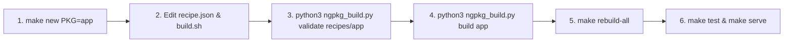

# OpenNGFW Package Manager (`ngpkg`) - AI Agent Packaging & Development Guide

> **Target Audience:** Autonomous AI agents and developers creating, modifying, or cross-compiling packages for OpenNGFW routers.

---

## 1. Architectural Principles & Target Hardware Constraints

1. **Primary Workspace:** All `ngpkg` development, client/server code, and recipe authoring **must strictly take place inside `~/ngpkg`**.
2. **Downstream Firmware Cache:** `AnbergearOS/dl/ngpkg` is a read-only build mirror used by Buildroot firmware generation (`post-build.sh`). Never edit files inside `AnbergearOS/dl/`.
3. **Target Router Environment:**
   * **Hardware:** Broadcom BCM4708 / ARMv7-A Dual-Core Cortex-A9 (e.g., Netgear R6300v2).
   * **RAM Constraints (128MB RAM Total):**
     * The root filesystem (`/`) and `/tmp` are in-memory RAM overlays (`tmpfs`).
     * **CRITICAL:** NEVER download large files (>10MB) or uncompress large tarballs into `/tmp`. Doing so consumes the entire 128MB RAM and triggers a fatal kernel OOM deadlock panic.
     * All persistent files, runtime databases, download folders, and caches MUST reside on USB storage (`/mnt/usb/`).
   * **Instruction Set & Float ABI:**
     * Architecture: ARMv7-A (32-bit little-endian).
     * C Standard Library: `musl` libc with soft-float ABI (`arm-buildroot-linux-musleabi-gcc.br_real`).
     * Go Runtime: MUST use `GOARCH=arm GOARM=5` (or soft-float compatible `GOARM=7`).
     * Binaries requiring ARMv8-A extensions or hard-float instructions will trigger **`SIGILL` (Exit code 132 / Illegal Instruction)**. (e.g., Syncthing v1.29.2 works natively; v2.x requires ARMv8 crypto extensions causing `SIGILL`).
   * **Installation Prefix:** Persistent USB storage mounted at `/mnt/usb/opt`.
   * **User Executables:** Symlinked automatically to `$HOME/.ngpkg-bin/` and `/root/.ngpkg-bin/`.

---

## 2. Unified Service Architecture: `systemctl` (MANDATORY)

OpenNGFW provides `/usr/bin/systemctl` as the unified system service manager across the entire operating system.

### Service Rules for AI Agents:
1. **Target `systemctl` Exclusively:**
   * **DO NOT** create, target, or reference legacy `/etc/init.d/` scripts in new or modified packages.
   * Every daemon or background service MUST be defined as a **systemd service unit file**.
2. **Staging Unit Files:**
   * Place unit file in `${STAGE_DIR}/etc/systemd/system/<service-name>.service`.
3. **Unit File Standard Schema:**
   ```ini
   [Unit]
   Description=My Daemon - Short Service Description
   After=network.target

   [Service]
   ExecStart=/mnt/usb/opt/bin/mydaemon --config=/mnt/usb/opt/etc/mydaemon/config.json
   Restart=on-failure
   RestartSec=5

   [Install]
   WantedBy=multi-user.target
   ```
4. **Lifecycle Hook Integration:**
   * **`install.sh` (Post-Install Hook):**
     ```bash
     #!/bin/sh
     set -e
     mkdir -p /etc/systemd/system 2>/dev/null || true
     ln -sf /mnt/usb/opt/etc/systemd/system/myservice.service /etc/systemd/system/myservice.service 2>/dev/null || true
     ```
   * **`uninstall.sh` (Pre-Remove Hook):**
     ```bash
     #!/bin/sh
     set -e
     systemctl stop myservice 2>/dev/null || true
     rm -f /etc/systemd/system/myservice.service /var/run/myservice.pid 2>/dev/null || true
     ```
5. **Managing Services on the Router:**
   ```bash
   systemctl start <service>
   systemctl stop <service>
   systemctl restart <service>
   systemctl status <service>
   systemctl enable <service>
   systemctl disable <service>
   ```

---

## 3. Recipe Structure & File Layout

Every package recipe resides in `recipes/<package-name>/` and adheres to this structure:

```text
recipes/<package-name>/
├── recipe.json        # [Mandatory] Package metadata manifest
├── build.sh           # [Mandatory] Cross-compilation & staging script
├── uninstall.sh       # [Mandatory for daemons] Router-side pre-remove teardown hook
└── install.sh         # [Mandatory for daemons] Router-side post-install setup hook
```

---

## 4. `recipe.json` Schema Specification

```json
{
  "name": "example-app",
  "version": "1.0.0",
  "description": "Short, clear description of the application for CLI and web UI",
  "category": "utilities",
  "license": "MIT",
  "homepage": "https://example.com",
  "type": "source",
  "binaries": [
    "bin/example-app"
  ],
  "dependencies": [],
  "hooks": {
    "post_install": "install.sh",
    "pre_remove": "uninstall.sh"
  }
}
```

### Standard Categories
* `utilities` - General tools (`nano`, `screen`, `btop`, `yt-dlp`, `ffmpeg`, `rsync`)
* `development` - Compilers, interpreters, runtime environments (`python3`, `v`, `git`, `tcc`, `lua`, `quickjs`)
* `networking` - Network daemons, servers, and VPN tools (`syncthing`, `caddy`, `samba`, `netclient`, `ufw`, `iperf`, `nmap`)
* `monitoring` - Monitoring tools (`htop`, `btop`)
* `system` - System environments (`debian`)
* `gaming` - Server daemons (`bareiron`)

---

## 5. Cross-Compilation & Staging Rules

### Environment Variables Provided to `build.sh`
When `framework/ngpkg_build.py` runs `build.sh`, the following environment variables are exported:

| Variable | Description | Example |
| :--- | :--- | :--- |
| `STAGE_DIR` | Absolute path to temporary package root hierarchy | `/tmp/ngpkg_stage_nano` |
| `CROSS_CC` | Cross-compiler executable | `.../arm-buildroot-linux-musleabi-gcc` |
| `CROSS_STRIP` | Cross-toolchain strip utility | `.../arm-buildroot-linux-musleabi-strip` |
| `CROSS_HOST` | GNU target triplet | `arm-buildroot-linux-musleabi` |
| `PKG_NAME` | Name from `recipe.json` | `nano` |
| `PKG_VERSION` | Version from `recipe.json` | `7.2` |
| `RECIPE_DIR` | Absolute path to current recipe directory | `~/ngpkg/recipes/nano` |
| `NGPKG_ROOT` | Absolute path to repository root | `~/ngpkg` |

### Critical Staging Guidelines for Agents

1. **Target Directory Structure:**
   * Binaries: `${STAGE_DIR}/bin/`
   * System Binaries: `${STAGE_DIR}/sbin/`
   * Shared Libraries: `${STAGE_DIR}/lib/`
   * Configuration: `${STAGE_DIR}/etc/`
   * Systemd Units: `${STAGE_DIR}/etc/systemd/system/`
   * Profile Environment Scripts: `${STAGE_DIR}/etc/profile.d/`
2. **Binary Stripping:**
   * Always run `${CROSS_STRIP} --strip-all <binary>` on all ELF binaries and `.so` files to keep package archives small.
3. **Shared Library Bundling:**
   * If a binary depends on standard runtime libraries (`libstdc++.so`, `libgcc_s.so`, `libncurses.so`), copy them from the compiler sysroot into `${STAGE_DIR}/lib/`:
   ```bash
   SYSROOT="$(${CROSS_CC} --print-sysroot 2>/dev/null || true)"
   if [ -d "${SYSROOT}/usr/lib" ]; then
       for lib in libstdc++ libgcc_s; do
           cp -P "${SYSROOT}/usr/lib/${lib}".so* "${STAGE_DIR}/lib/" 2>/dev/null || true
       done
   fi
   ```
4. **Handling Pre-Compiled ARM Binaries:**
   * Pre-compiled Alpine musl packages use `/lib/ld-musl-armhf.so.1 -> libc.so`.
   * In the recipe `build.sh`, write a shell wrapper in `bin/<app>` ensuring `LD_LIBRARY_PATH="/mnt/usb/opt/lib:$LD_LIBRARY_PATH"` is exported before launching the binary:
   ```bash
   cat << 'EOF' > "${STAGE_DIR}/bin/myapp"
   #!/bin/sh
   export LD_LIBRARY_PATH="/mnt/usb/opt/lib:$LD_LIBRARY_PATH"
   export PATH="/mnt/usb/opt/bin:$PATH"
   exec /mnt/usb/opt/bin/myapp.bin "$@"
   EOF
   chmod 755 "${STAGE_DIR}/bin/myapp"
   ```

---

## 6. Step-by-Step Recipe Creation Workflow



### 1. Scaffold New Recipe
```bash
make new PKG=ripgrep
```

### 2. Implement `recipes/ripgrep/recipe.json` & `build.sh`
Fill in metadata, download source or binaries, cross-compile, strip, and stage into `${STAGE_DIR}`.

### 3. Validate
```bash
python3 framework/ngpkg_build.py validate recipes/ripgrep
```

### 4. Build Individual Package
```bash
python3 framework/ngpkg_build.py build ripgrep
```

### 5. Full Clean-Slate Rebuild
```bash
make rebuild-all
```

---

## 7. Testing & Verification Checklist for AI Agents

Before submitting code or finalizing packages, verify:
- [ ] `python3 framework/ngpkg_build.py validate recipes/<name>` passes with 0 errors.
- [ ] Binary files in package archive are verified ARM 32-bit ELF (`file` or `readelf -h`).
- [ ] Any daemons provide a systemd unit in `${STAGE_DIR}/etc/systemd/system/<name>.service`.
- [ ] `install.sh` and `uninstall.sh` use `systemctl` / `/etc/systemd/system/` (NO `init.d` references).
- [ ] Executable wrapper scripts have `chmod 755`.
- [ ] `make test` passes.
- [ ] Package archive is generated in `repo/packages/<name>-<version>.ngpkg`.
- [ ] `repo/packages/index.json` and `repo/packages/index.txt` contain the new entry.
